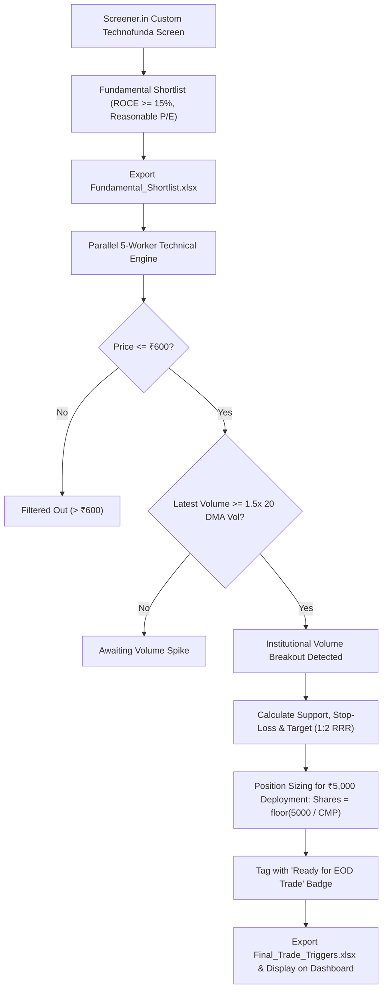

# TechnoFunda Swing Bot 🚀📈

> **Automated Indian Stock Market Swing Trading System (NSE / BSE)**  
> Built with **FastAPI**, **Pandas**, **BeautifulSoup4**, **ThreadPoolExecutor**, and a sleek **Dark-Mode Tailwind CSS** dashboard.

---

## 🌟 Overview & Key Features

**TechnoFunda Swing Bot** is a production-grade algorithmic swing trading screener and execution assistant tailored for retail swing traders trading the Indian equity markets (NSE/BSE).

1. **Fundamental Screening:**
   - Scrapes custom fundamental screens from Screener.in: [`https://www.screener.in/screens/4056640/technofunda/`](https://www.screener.in/screens/4056640/technofunda/).
   - Paginates through all pages, extracting **Company Name**, **CMP (Price)**, **Market Cap**, **ROCE (%)**, and **P/E ratio**.
   - Automatically exports results to `Fundamental_Shortlist.xlsx`.
   - Incorporates a seamless fallback dataset if Screener.in screens are private (404) or rate-limited.

2. **Parallel Technical Analysis Engine:**
   - Concurrently processes historical OHLCV data using `concurrent.futures.ThreadPoolExecutor(max_workers=5)` to maximize speed without triggering rate-limits.
   - Evaluates **20-Day Simple Moving Average Volume (20 DMA Vol)**.
   - Computes **Volume Breakouts ($\ge 1.5\times$ 20 DMA Volume)** to detect institutional accumulation.
   - Detects recent **Support Zones** (20-day lowest low) and **Resistance Zones** (20-day swing high).

3. **Position Sizing & Money Management (₹10,000 Capital):**
   - **Price Filter:** Filters stocks trading strictly under **₹600 per share**, allowing a small ₹10,000 capital account to take sizable positions (10–25 shares) rather than odd fractional amounts.
   - **Deployment Limit:** Sized for **₹5,000 per trade** (maximum 50% capital allocation, permitting 2 concurrent swing trades).
   - **Position Size Formula:** $\text{Shares} = \lfloor \frac{5000}{\text{CMP}} \rfloor$.
   - **Stop-Loss Level:** Set 1.5% below recent support zones (capped at max 6% risk from entry).
   - **1:2.0+ Risk-Reward Ratio (RRR):** Target placed at minimum $2.2\times$ risk per share.
   - Outputs final trade triggers directly to `Final_Trade_Triggers.xlsx`.

4. **Modern Dark-Mode Dashboard:**
   - Dark aesthetic styled with Tailwind CSS and FontAwesome 6.
   - Top stats bar showcasing Total Capital (₹10,000), Per-trade Sizing (₹5,000), Watchlist Count, and Actionable Breakouts.
   - Interactive **"Run Full Scan"** button with live progress spinner and status badges.
   - Final Stocks Table with Glowing "Ready for EOD Trade" action badges.
   - Interactive Canvas-based Candlestick & 20 DMA Volume breakout charts.
   - Real-time Position Sizing calculator in the modal window.
   - Live activity terminal logging every pipeline step.

---

## 📁 Project Architecture

```
Technofunda/
│
├── backend/
│   ├── __init__.py              # Backend package initializer
│   ├── main.py                  # FastAPI application & REST endpoints
│   ├── screener_fetcher.py      # Scrapes Screener.in with pagination & fallback
│   ├── technical_engine.py      # Parallel ThreadPoolExecutor breakout scanner
│   └── requirements.txt         # Python dependencies
│
├── frontend/
│   └── templates/
│       └── index.html           # Dark-mode Tailwind dashboard UI
│
├── Fundamental_Shortlist.xlsx   # Generated fundamental shortlist
├── Final_Trade_Triggers.xlsx    # Generated EOD trade triggers
└── README.md                    # System documentation
```

---

## 🛠️ Installation & Setup

### Prerequisites
- Python 3.10+ (Tested on Python 3.13)
- `pip`

### Step 1: Install Dependencies
Open your terminal in the project root and install requirements:
```bash
pip install -r backend/requirements.txt
```

### Step 2: Start the Web Application
Run the FastAPI development server:
```bash
python -m uvicorn backend.main:app --host 127.0.0.1 --port 8000 --reload
```
or directly run:
```bash
python backend/main.py
```

### Step 3: Open the Dashboard
Open your web browser and navigate to:
```
http://127.0.0.1:8000/
```

---

## 📡 REST API Reference

| Method | Endpoint | Description |
|---|---|---|
| `GET` | `/` | Serves the interactive Dark Mode Dashboard UI |
| `POST` | `/api/run-pipeline` | Executes end-to-end Screener scraping and parallel technical scan |
| `GET` | `/api/final-stocks` | Returns JSON of final shortlisted breakout stocks ready for EOD execution |
| `GET` | `/api/fundamental-stocks` | Returns JSON of all fundamental shortlisted stocks |
| `GET` | `/api/status` | Returns system status, timestamps, and activity logs |
| `GET` | `/api/stock/{ticker}/chart` | Returns 60-day OHLCV candlesticks & 20 DMA volume for charts |
| `GET` | `/api/download/triggers` | Directly downloads `Final_Trade_Triggers.xlsx` |
| `GET` | `/api/download/fundamentals` | Directly downloads `Fundamental_Shortlist.xlsx` |

---

## 📈 Swing Trading Strategy Rules



### Mathematical Formulations

1. **Volume Spike Multiplier ($M_{\text{vol}}$):**
   $$M_{\text{vol}} = \frac{\text{Latest Volume}}{\text{SMA}_{20}(\text{Volume})}$$
   *Trigger Condition:* $M_{\text{vol}} \ge 1.50$.

2. **Price Ceiling Constraint:**
   $$\text{CMP} \le \text{₹}600.00$$

3. **Stop-Loss Formulation:**
   $$\text{SL} = \max(\text{Support Zone} \times 0.985, \; \text{CMP} \times 0.94)$$

4. **Position Sizing for ₹5,000 Deployment:**
   $$\text{Shares} = \left\lfloor \frac{5000}{\text{CMP}} \right\rfloor$$
   $$\text{Capital Deployed} = \text{Shares} \times \text{CMP}$$
   $$\text{Capital at Risk} = \text{Shares} \times (\text{CMP} - \text{SL})$$

---

## 🧪 Testing Modules Independently

- **Test Fundamental Scraper:**
  ```bash
  python backend/screener_fetcher.py
  ```
- **Test Parallel Technical Engine:**
  ```bash
  python backend/technical_engine.py
  ```

---

## 🛡️ License & Disclaimer
This software is built for educational and research purposes. Stock market trading entails financial risk. Always test with paper trading and apply risk management before deploying real capital.
